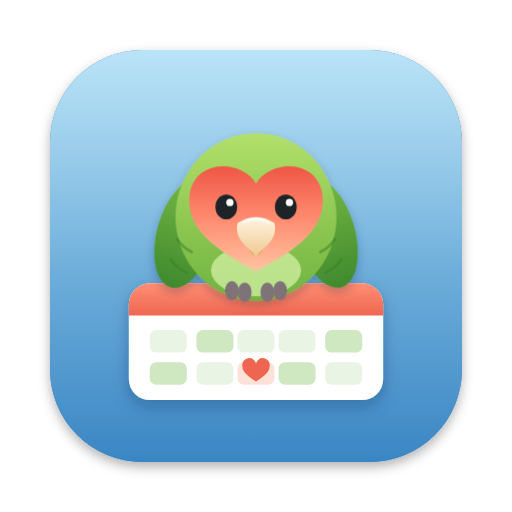

<p align="center">
  
</p>

<h1 align="center">Amor</h1>

<p align="center">
  Photograph the duty roster, and every shift goes into your calendar.<br>
  A lovebird that reads POLYPOINT/PEP rosters for you.
</p>

<p align="center">
  <a href="https://amor.kimiyu.ch"><b>Open Amor</b></a>
</p>

---

Amor reads one person's row from a photographed duty roster ("Dienstplan") with Claude, lets you check the days, and publishes the shifts as a calendar feed that iPhone, Mac and Google Calendar subscribe to. A corrected roster updates the events, and shifts removed from the plan disappear.

A Laravel 13 app with Tailwind CSS 4 and SQLite, behind one password. The original spec is in [docs/spec.md](docs/spec.md).

## Local development

The site runs in [Herd](https://herd.laravel.com) at `https://amor.web.test`.

```sh
composer install
npm install
cp .env.example .env && php artisan key:generate
touch database/database.sqlite && php artisan migrate
npm run dev           # or: npm run build
php artisan queue:work --timeout=900   # reads the rosters
```

In `.env`:

| | |
|---|---|
| `AMOR_PASSWORD` | The password that opens Amor. Changing it signs out every device. Without it, Amor stays closed. |
| `ANTHROPIC_API_KEY` | Used to read the photos with Claude. |
| `AMOR_MODEL` | `claude-opus-5-5` by default. |
| `AMOR_TIMEZONE` | Shift times are wall-clock times in this zone (`Europe/Zurich`). |
| `GOOGLE_CLIENT_ID`, `GOOGLE_CLIENT_SECRET` | Optional. Lets Amor write the shifts straight into a Google calendar (Settings → Connect Google Calendar). OAuth client of type *Web application*, redirect URI `https://amor.kimiyu.ch/google/callback`. |
| `AMOR_FAKE_READER` | `true` reads a made-up roster instead of calling Claude (for UI work). |
| `DB_QUEUE_RETRY_AFTER` | Keep at `1200`: a scan can take minutes, and must not be handed to a second worker. |

## Tests

```sh
php artisan test      # feature and unit tests, with the fake reader
npm run e2e           # the whole flow in a phone-sized browser against Herd
npm run e2e -- webkit
```

The end-to-end test needs `AMOR_FAKE_READER=true`, `AMOR_PASSWORD=amor` and a running queue worker. It signs in, uploads `tests/fixtures/roster.jpg`, waits for the reading, edits codes, saves, sets shift times and checks the calendar feed. Screenshots go to `tests/screenshots/`.

## Deploying

```sh
npm run build     # if you changed the design; commit public/build
./deploy.sh
```

`deploy.sh` runs the tests, exports the committed code, installs production dependencies, syncs it to Hostpoint over SSH with your own key, and migrates the database. The server's `.env`, `database/database.sqlite` and `storage/` are left alone. GitHub Actions only runs the tests.

The server needs, once:

- `.env` in `/home/pumutuxu/www/amor.kimiyu.ch` (from `.env.example`, with `APP_ENV=production`, `APP_DEBUG=false`, `APP_URL=https://amor.kimiyu.ch`, `AMOR_PASSWORD` and `ANTHROPIC_API_KEY`).
- A cron job that runs the queue worker (rosters are read in the background, because a scan can take longer than a web request may run):
  ```
  * * * * * cd /home/pumutuxu/www/amor.kimiyu.ch && /usr/local/php83/bin/php artisan queue:work --max-time=55 --sleep=2 --timeout=900 --tries=1 >> /dev/null 2>&1
  ```

## How it works

1. You enter the name in the roster and take a photo. The browser converts it to a JPEG of at most 4000 px; the server stores it and queues `App\Jobs\ReadRoster`.
2. `App\Roster\ClaudeRosterReader` sends Claude a ≈2000 px overview and a `zoom` tool that crops the original photo (`App\Roster\Photo`, Imagick). Claude zooms into the header and the person's row and answers with a JSON schema: period, row label, row box, and a code per day with an "uncertain" flag. The loop is capped at 14 turns; refusals fall back to another model server-side (`fallbacks: "default"`). The waiting page shows the progress.
3. The photo is deleted once read; only a strip of the person's row is kept, to compare against.
4. On the review page you correct codes, then save. Shifts in the roster's period are replaced.
5. With Google Calendar connected (`App\Calendar\GoogleCalendar`), saving writes the period into the chosen calendar: one event per shift with a fixed ID per date (`amor20261201`), updated on every save, deleted when the shift is gone. Changing shift times in Settings updates the upcoming events. The refresh token is stored encrypted in the database.
6. Otherwise, the saved shifts can be added as a file (Add All on iPhone), and `/feed/<secret>.ics` (`App\Calendar\IcsFeed`) publishes all shifts. Codes become events through the shift code table in Settings: with times a timed event (ending the next day if the end is before the start), without times an all-day event, *Skip* no event. Event IDs are stable per date. The feed URL is the only thing protecting it; Settings can create a new one.

## Where things are

| | |
|---|---|
| `app/Roster/` | Reading a roster photo with Claude (and the fake reader for tests) |
| `app/Calendar/` | Code → event mapping and the iCalendar feed |
| `app/Jobs/ReadRoster.php` | The background job around the reader |
| `app/Http/Middleware/RequirePassword.php` | The one-password sign-in (a year-long cookie) |
| `resources/views/` | Pages: login, home, scans (progress, review), settings |
| `resources/css/app.css` | Theme colors `sky` (icon background), `leaf` (the lovebird), `peach` (its face; buttons) |
| `scripts/make-icon.mjs` | Draws the icon (a peach-faced lovebird with a heart-shaped face on a calendar page) and renders every PNG (`npm run icons`) |
